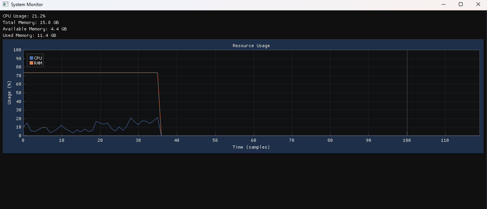

# Sytem Monitoring Platform
This is a simple system monitor to see real-time usage statistics for different components.

## Supported Components
- CPU Usage
- Total RAM
- Available RAM
- Used RAM

## Supported Operating Systems
- Linux
- Windows

## Instructions for Use
1. Download the relase for your OS
2. Unzip the files
3. Run the application